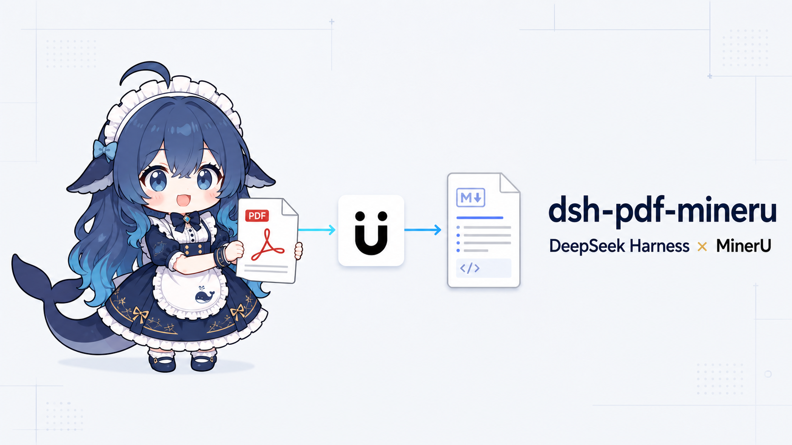
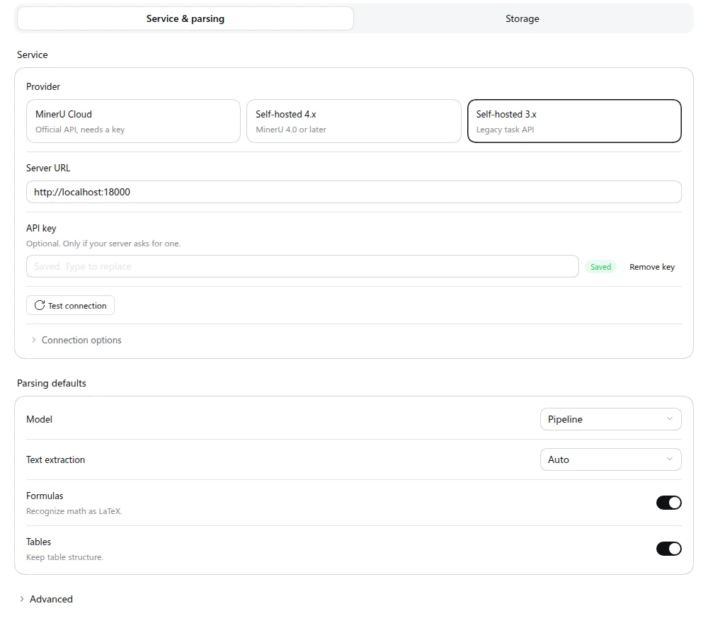

<div align="center">



# dsh-pdf-mineru

**用 MinerU 解析 PDF，让 DeepSeek Harness 里的 Agent 按证据阅读文档**

支持 MinerU 官方云（v4）、自部署 MinerU 4.x（V1 API）和 3.x（旧版任务 API）。Agent 可以分段读取正文、公式、表格和插图，长文档在后台解析，关键内容可在本地回看原页核对。

<p>
  <a href="https://awesome-dsh-plugin.com"></a>
  <a href="https://www.npmjs.com/package/dsh-pdf-mineru"></a>
  <a href="./package.json">=24"></a>
  <a href="./package.json">=0.2.1-rc.2 <0.3.0-0"></a>
  
  <a href="./LICENSE"></a>
</p>

[核心亮点](#核心亮点) · [快速开始](#快速开始) · [模型工具](#模型工具一览) · [原页核对](#原页核对的依赖) · [常见问题](#常见问题) · [文档](#文档)

</div>

## 核心亮点

- **按证据阅读**：目录、字面检索、稳定块 ID 和物理页码帮助 Agent 定位内容；公式、数值和图表可以回看原页核对，不假设 OCR 无误。
- **三种 Provider 显式切换**：官方云免部署；自部署服务让文档留在内网。三种协议共用同一套工具参数。
- **后台解析长文档**：几十到几百页的文档可提交为 DSH 原生后台任务，解析期间不阻塞对话，完成后由 DSH 通知。
- **内容寻址缓存**：按文件内容和解析配置复用已发布结果，同一份文档不重复上传解析。
- **Web 设置页**：在 Plugins 页面配置 Provider、测试连接、管理缓存；修改需显式保存，破坏性操作先预览再确认。

## 快速开始

### 环境要求

- DeepSeek Harness：版本范围以 [package.json](./package.json) 的 `engines.dsh` 为准（当前为 `>=0.2.1-rc.2 <0.3.0-0`）。
- Node.js `^22.19.0 || >=24.0.0`。
- 设置页需要 DSH Web；没有 Web 服务的宿主仍可使用两个模型工具，配置直接写在 profile 中。

### 安装

```sh
dsh plugin --profile web add dsh-pdf-mineru
```

本地开发时可以安装源码目录。仓库不提交构建产物，安装前先在源码目录执行 `pnpm install && pnpm run build`：

```sh
dsh plugin --profile web add link:/absolute/path/to/dsh-pdf-mineru
```

### 升级

- Web：在 **Plugins / 插件** 页面找到 dsh-pdf-mineru，点击 **更新**。
- CLI：先移除再安装：

  ```sh
  dsh plugin --profile web remove dsh-pdf-mineru
  dsh plugin --profile web add dsh-pdf-mineru
  ```

如果新版本要求更高的 DSH，请先升级宿主。旧版配置会在读取时自动转换，在设置页点击保存后才写回。多个进程共享同一缓存目录时，请先停止全部进程再升级，详见[配置与运维指南](docs/configuration.md#多进程共享-storageroot)。

### 选择 Provider

打开 **Plugins / 插件 → dsh-pdf-mineru**，在「服务与解析」标签选择服务类型。修改先进入草稿，点击 **保存** 才生效；**测试连接** 使用草稿中的地址等设置，但只使用已保存的 API Key。

<p align="center">
  
</p>

**A. MinerU 官方云（免部署）**

1. 在 [mineru.net](https://mineru.net) 注册并创建 API Token。
2. 选择「MinerU 云服务」，在 API Key 输入框粘贴 Token，点击 **保存**。密钥由 DSH 凭据服务保管，不写入插件配置。
3. 点击 **测试连接** 确认可用。

**B. 自部署 MinerU 4.x（V1 API）**

1. 启动 MinerU 4.x 的 API 服务（常见地址 `http://localhost:8000`）。
2. 选择「自部署 4.x」，填写服务地址；本机 HTTP 地址需在「连接选项」中开启「允许 HTTP 明文连接」。
3. 按需选择解析档位（tier）和 OCR 模式（auto / txt / ocr），测试连接后保存。

**C. 自部署 MinerU 3.x（旧版任务 API）**

1. 启动 MinerU 3.x 服务（常见地址 `http://localhost:18000`）。
2. 选择「自部署 3.x」，填写服务地址和 Pipeline/VLM 后端名称，本机 HTTP 同样需要显式允许。
3. 测试连接后保存。

协议由你显式选择，插件不会自动探测或降级到另一种协议。不要把 VLM 推理服务的地址当作 MinerU API 填入。各字段含义、YAML 写法与凭据规则见[配置与运维指南](docs/configuration.md)。

### 开始对话

配置完成后直接用自然语言提出需求，Agent 会自行选择工具：

- “读一下 `paper.pdf` 的目录，然后找出第 3 节里所有带编号的公式。”
- “在后台解析 `/data/annual-report.pdf`，完成后告诉我它有哪些章节和表格。”
- “第 7 页那张表的数值看起来不对，对照原页核对一下。”

相对路径按当前会话的工作目录解析；也可以直接引用会话里上传的 PDF 附件。

## 模型工具一览

| 工具 | 用途 |
| --- | --- |
| `read_pdf` | 同步读取：目录、字面检索、按块或按页精读，分段续读，以及本地原页核对（`view: "page"`） |
| `async_parse_pdf` | 把整份文档提交为 DSH 后台任务，完成后返回结构摘要；之后用 `read_pdf` 按需阅读 |

两个工具都接受 `file_path` 或 `attachment_id`（二选一）。参数、响应字段、预算与错误恢复见 [PDF 阅读契约](docs/model-reading.md)。

## 原页核对的依赖

原页核对在本地渲染，不上传文件，也不调用 Provider：

- 优先使用 PATH 中的 Poppler（`pdfinfo`、`pdftoppm`）。
- 找不到或无法执行 Poppler 时，自动改用随插件安装的 PDF.js 和 `@napi-rs/canvas`。Canvas 使用上游为常见 Linux、macOS、Windows 平台提供的预编译包，无需编译或安装 Poppler。
- 安装插件时不要使用 `--no-optional`，否则会缺少 Canvas 平台包。两个后端都不可用时会提示安装 Poppler，普通文本阅读不受影响。

渲染器有超时、并发和尺寸限制，但它不是操作系统级沙箱；处理不可信 PDF 时仍需宿主层面的隔离。具体限制见 [ARCHITECTURE.md](ARCHITECTURE.md#原页渲染)。

## 常见问题

<details>
<summary><strong>API Key 应该放在哪里？</strong></summary>

推荐在设置页输入，密钥由 DSH 凭据服务保管。也可以导出与「凭据引用名」同名的环境变量（默认 `MINERU_API_KEY`），但 DSH 中保存的值优先于环境变量。详见[凭据](docs/configuration.md#凭据)。
</details>

<details>
<summary><strong>扫描件识别效果不好怎么办？</strong></summary>

在设置页把解析方式改为 `ocr`（4.x V1 对应各 profile 的 OCR 模式）。模型工具不接受 `ocr`、`model` 等解析参数，不能让 Agent 通过工具参数切换。修改解析配置会产生新的缓存身份，下次读取会重新解析。
</details>

<details>
<summary><strong>Pipeline 和 VLM 有什么区别？</strong></summary>

两者是官方云和 3.x 旧版服务的解析模型。Pipeline 速度快、资源占用低，适合多数常规版面；VLM 使用视觉多模态模型，复杂图文混排和特殊公式效果通常更好。4.x V1 不选择模型，改用解析档位。
</details>

<details>
<summary><strong>解析结果存在哪里？怎么清理？</strong></summary>

默认在 `$DSH_HOME/cache/pdf-mineru/`。在设置页「存储」标签中可以查看统计、校验完整性和清除缓存；清除前会先显示预览，确认后才删除。有读取或解析正在进行时，清理会被拒绝。详见[存储与维护](docs/configuration.md#存储缓存与维护)。
</details>

<details>
<summary><strong>后台任务可以取消吗？</strong></summary>

可以，用 DSH 的通用任务工具（如 `job_kill`）。取消只结束这一次等待；如果别的调用也在等待同一份文档的解析，那次解析会继续完成。
</details>

<details>
<summary><strong>保存时提示配置已被修改？</strong></summary>

说明从打开设置页到保存期间，配置被其他窗口或进程改过。请按提示重新加载后再修改，插件不会覆盖别人的修改。
</details>

<details>
<summary><strong>通过局域网地址打开 Web 时，设置页读不到配置？</strong></summary>

设置与维护接口只接受回环地址访问（`localhost`、`127.x.x.x`、`[::1]`）。请在运行 DSH 的机器上通过回环地址打开 Web。模型工具不受此限制。
</details>

## 文档

- [配置与运维指南](docs/configuration.md)：设置页、Provider 参考、凭据、迁移、缓存维护、多进程共享。
- [PDF 阅读契约](docs/model-reading.md)：两个工具的参数、响应字段、预算和错误恢复。
- [ARCHITECTURE.md](ARCHITECTURE.md)：模块边界与实现约束（面向贡献者）。
- [CONTRIBUTING.md](CONTRIBUTING.md)：开发、测试与发布流程。
- [CHANGELOG.md](CHANGELOG.md)：版本变更。

## 许可证与致谢

- 本项目基于 [MIT License](./LICENSE) 开源。
- 感谢 [DeepSeek Harness](https://github.com/deepseek-ai/deepseek-harness) 提供的插件体系。
- 感谢 [OpenDataLab MinerU](https://github.com/opendatalab/MinerU) 提供的文档解析能力。
- 感谢 [Huanlin/dsh-plugin-mineru](https://github.com/HuanLinOTO/dsh-plugin-mineru) 带来的早期设计灵感。
- 本插件已被 [Awesome DeepSeek Harness Plugin](https://github.com/awesome-dsh-plugin/awesome-dsh-plugin) 社区精选列表收录（[收录详情页](https://awesome-dsh-plugin.com/p/Yurzi/dsh-pdf-mineru)）。
- Banner 图像中的 DeepSeek 鲸鱼娘形象由上善无形原创角色与 ZipZipPipe 二创设计衍生，遵循 [CC BY-NC-SA 4.0](https://creativecommons.org/licenses/by-nc-sa/4.0/deed.zh-hans) 许可。
